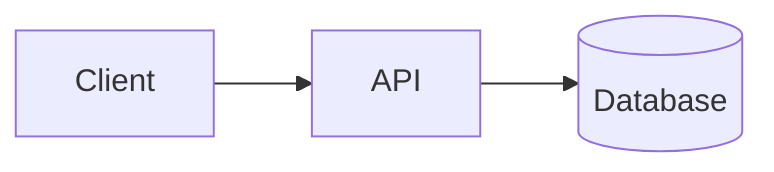

# Zensical Static Documentation Generator (`tool-zensical`)

`zensical` is a fast static documentation site generator written in Rust
and Python by the creators of *Material for MkDocs* and *mkdocstrings*. It
replaces legacy `mkdocs.yml` configurations with clean, typed `zensical.toml`
files, instant live reloading, and native support for Mermaid diagrams, MathJax
math, and `mkdocstrings`.

In Zenith projects, `zensical` manages all public documentation and API
references.

---

## 1. Core CLI Commands

Serve documentation locally or compile production static sites.

```bash
uv run zensical serve                  # Start live-reloading dev server
uv run zensical build                  # Build static site into site/
uv run zensical build --strict --clean # Production build with strict checks
```

Zenith wires documentation tasks into Poe:

```bash
uv run poe docs-serve                  # Runs zensical serve
uv run poe docs-build                  # Runs zensical build --strict --clean
```

---

## 2. Configuration Location

Configure Zensical through **`zensical.toml`** at the project root.
For the complete drop-in production configuration, see:
👉 [templates/zensical.toml](./templates/zensical.toml)

Baseline configuration:

```toml
[project]
site_name = "My Project"
site_description = "A modern Python project"
site_author = "Jane Developer"
site_url = "https://username.github.io/my-project/"
repo_name = "username/my-project"
repo_url = "https://github.com/username/my-project"
edit_uri = "edit/main/docs/"

# Documentation Navigation Hierarchy
nav = [
    { "Overview" = "index.md" },
    { "Getting Started" = "getting-started.md" },
    { "Reference" = "reference.md" },
]

extra_css = [
    "stylesheets/palette.css",
    "stylesheets/custom.css",
]

# Strict Build-Time Validation
[project.validation]
invalid_links = true
invalid_link_anchors = true
unresolved_references = true
unresolved_footnotes = true

# Theme, Markdown Extensions & Plugins
[project.theme]
language = "en"
logo = "assets/python-logo.svg"

[project.plugins.gh-admonitions]
[project.plugins.markdown-exec]
[project.plugins.llmstxt]
[project.plugins.mkdocstrings.handlers.python]
inventories = ["https://docs.python.org/3/objects.inv"]
paths = ["src"]
```

---

## 3. Common Configuration Changes During Development

Manage pages, navigation, automated API docs, and interactive diagrams with
these patterns.

### A. Adding a New Documentation Page

1. Create the markdown file inside `docs/` (for example, `docs/architecture.md`).
2. Register the page in `project.nav` in `zensical.toml`:

   ```toml
   nav = [
       { "Overview" = "index.md" },
       { "Getting Started" = "getting-started.md" },
       { "Architecture" = "architecture.md" },
       { "Reference" = "reference.md" },
   ]
   ```

3. For nested sections:

   ```toml
   nav = [
       { "Home" = "index.md" },
       { "Guides" = [
           { "Installation" = "guides/install.md" },
           { "Deployment" = "guides/deploy.md" },
       ] },
   ]
   ```

### B. Auto-Documenting Python Code with `mkdocstrings` & `griffe`

In any markdown document (for example, `docs/reference.md`), use the `:::` block:

```markdown
# API Reference

::: my_package.core
    options:
      show_source: true
      members:
        - get_greeting
```

Zensical automatically reloads docs when source files in `src/` change:

- **Cross-References & Backlink Trees**: Setting `options.backlinks = "tree"`
  and crossref flags resolves type annotations to upstream or local docs.
  Each symbol renders a collapsible tree of pages that reference it.
- **PEP 695 Type Parameters**: `options.show_signature_type_parameters = true`
  renders Python 3.12+ generic syntax in signatures. Ruff formats these signatures
  using `options.line_length = 88`.
- **Auto Summary Tables & Class Diagrams**: `options.summary = true` generates
  module/class summary tables automatically, and
  `options.show_inheritance_diagram = true` renders inline SVG class hierarchy
  diagrams.
- **PEP 702 Deprecation Badges**: `options.extensions = ["griffe_warnings_deprecated"]`
  inspects `@warnings.deprecated("...")` decorators via AST and renders
  structured deprecation admonitions automatically.
- **Floating Link Previews**: Setting `zensical.extensions.preview.targets.include = ["*"]`
  enables floating preview cards on internal links. Note: an empty `preview = {}`
  table is a no-op because `targets.include` defaults to empty.
- **GitHub-Style Alerts (`gh-admonitions`)**: `[project.plugins.gh-admonitions]`
  natively converts `> [!NOTE]`, `> [!TIP]`, `> [!IMPORTANT]`, `> [!WARNING]`,
  and `> [!CAUTION]` blockquotes into styled Zensical admonitions.

### C. Detecting Breaking Public API Changes (`griffe check`)

`griffe` installs alongside `mkdocstrings[python]`. Use it to compare the
current AST against the latest git tag. This detects breaking public API changes
(such as removed parameters or narrowed types) before releasing:

```bash
uv run poe check-api   # Runs: griffe check <package_name> --search src
```

### D. Using Mermaid Diagrams

Zensical supports Mermaid natively. Write standard markdown fences:

````markdown

````

### E. Dynamic Code Execution & Directory Trees with `markdown-exec`

With `[project.plugins.markdown-exec]` enabled, Zensical registers custom
fences for `python`, `py`, `pycon`, `console`, `sh`, `bash`, and `tree`
automatically:

````markdown
```python exec="on" session="quickstart" source="material-block" result="ansi"
import sys

print(f"Built with Python {sys.version.split()[0]}")
```
````

- **Session Persistence**: Blocks sharing `session="name"` reuse variables and
  imports across a page.
- **Doctest (`pycon`) & Shell (`console`) Execution**: Execute interactive
  REPL transcripts or shell commands automatically. You do not need to write
  `exec="on"` when using `pycon`.
- **Rich Directory Trees (` ```tree `)**: Render styled filesystem trees with
  Material SVG folder/file icons from plain indented text:

  ````markdown
  ```tree
  ./
      pyproject.toml
      zensical.toml
      src/
          my_package/
              __init__.py
  ```
  ````

### F. Embedding Tested Code Snippets with `pymdownx.snippets`

Embed external source files directly into documentation using `--8<--`.
Settings like `pymdownx.snippets.check_paths = true` fail the build if a
referenced file does not exist.

````markdown
```python
--8<-- "examples/quickstart.py"
```
````

### G. Custom Color Palette & Theming (`palette.css` & `custom.css`)

Zenith styles Zensical documentation with a modular two-file CSS architecture
located in `docs/stylesheets/`:

- **`palette.css`**: Defines global color tokens on `:root` organized by hue and
  lightness. It uses the Catppuccin palette (Latte for light, Mocha for dark),
  harmonized with the Typst logo colors (`#387eb8` blue and `#ffc331` gold).
- **`custom.css`**: Maps these design tokens to Zensical's theme variables.
  It sets primary and accent colors for default and slate schemes,
  shifting the dark hue into midnight indigo.

---

## 4. Guidelines and Troubleshooting

Follow these guidelines to maintain documentation:

- **Always build with `--strict`**: Running `uv run poe docs-build`
  checks all internal links, anchors, and docstring references. Never
  deploy a build with broken links. (Note: `zensical serve` does not currently
  support `--strict`. Run `zensical build --strict` to check before you commit.)
- **Automated `llms.txt` & `llms-full.txt` Generation**: Zensical's built-in
  Rust `[project.plugins.llmstxt]` plugin automatically compiles `site/llms.txt`
  and `site/llms-full.txt` (including rendered `mkdocstrings` API signatures)
  during `zensical build`. When adding new pages to `nav` in `zensical.toml`,
  also add them under `[project.plugins.llmstxt.sections]` and `docs/llms.txt`.
- **Image Paths**: Keep asset images in `docs/assets/` and reference them
  using relative paths (`assets/my-image.png`).
