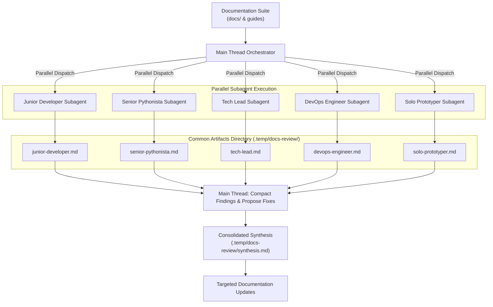

# Documentation Consumer Review Workflow (`workflow-docs-consumers`)

This skill defines the procedure to evaluate documentation through simulated developer personas.

Technical writers and code authors suffer from the curse of knowledge.
Authors understand architecture details and accidentally omit essential onboarding context.
This workflow dispatches independent reader agents with simulated backgrounds to audit documentation before release.

> [!IMPORTANT]
> This skill operates with `disable-model-invocation: true`.
> Run it only when the user explicitly asks for a persona review.

---

## 1. Multi-Persona Evaluation Model

Reviewing documentation through a single perspective creates blind spots.
This project evaluates documentation across complementary developer archetypes:



Consult [references/personas.md](./references/personas.md) for full descriptions of all persona archetypes.

---

## 2. End-to-End Execution Procedure

Follow these four steps to execute a documentation consumer audit:

### Step 1: Select Evaluation Personas
Select two to three complementary personas based on your review goals:
- For onboarding and usability: Pair **The Junior Developer** and **The Solo Prototyper**.
- For architectural rigor: Pair **The Senior Pythonista** and **The Tech Lead**.
- For platform and operations: Pair **The DevOps Engineer** and **The Tech Lead**.
- For a full audit: Dispatch all five personas before major releases.

### Step 2: Dispatch Independent Reader Subagents in Parallel
Dispatch selected personas simultaneously as parallel subagents with clean context:
1. Provide the persona mandate using [templates/persona_prompt.md](./templates/persona_prompt.md).
2. Set read-only permissions for project documentation and source files.
3. Instruct each subagent to read the documentation independently in parallel.
4. Require each subagent to save its evaluation report artifact in a shared location:
   `.temp/docs-review/<persona-slug>.md`.
5. Require each subagent to send a completion notification to the main thread.

### Step 3: Compact Multi-Persona Findings in the Main Thread
When all parallel subagents complete their reviews, the main thread collects all artifacts:
1. **Compact Overlapping Feedback**:
   - Merge findings that repeat or touch similar issues from different viewpoints.
   - For example, combine beginner confusion about tool commands with senior requests for tool configuration flags into a single documentation task.
2. **Reconcile Persona Tensions**:
   - Resolve opposing feedback between personas (such as beginner simplicity against senior technical depth) through progressive disclosure.
3. **Formulate Concrete Fixes**:
   - Translate compacted findings into specific edits with target file paths and proposed text changes.
   - Save the consolidated review matrix to `.temp/docs-review/synthesis.md`.
   - Present proposed changes to the team for review before editing files.

### Step 4: Implement Refinements and Verify
Apply approved edits to documentation files:
1. **Clarify Onboarding**: Add explicit definitions and quick translation tables for beginners.
2. **Defend Trade-offs**: Add architectural justifications for senior reviewers.
3. **Calibrate Tone**: Ensure tone remains supportive, empowering, and free from empty marketing buzzwords.
4. **Run Verification Gates**:
   ```bash
   uv run poe format-md
   uv run poe lint-md
   uv run poe docs-build
   uv run poe code-quality
   ```

---

## 3. Templates and References

- [templates/persona_prompt.md](./templates/persona_prompt.md) — Subagent dispatch prompt template.
- [templates/evaluation_report.md](./templates/evaluation_report.md) — Structured report schema for persona findings.
- [references/personas.md](./references/personas.md) — Master catalog of five developer persona archetypes.
  - [references/junior-developer.md](./references/junior-developer.md) — Onboarding friction and beginner misconceptions.
  - [references/senior-pythonista.md](./references/senior-pythonista.md) — Architecture choices and tool trade-offs.
  - [references/tech-lead.md](./references/tech-lead.md) — Team velocity, maintenance cost, and business ROI.
  - [references/devops-engineer.md](./references/devops-engineer.md) — CI/CD performance and containerization.
  - [references/solo-prototyper.md](./references/solo-prototyper.md) — Development velocity, minimal ceremony, and modularity.
