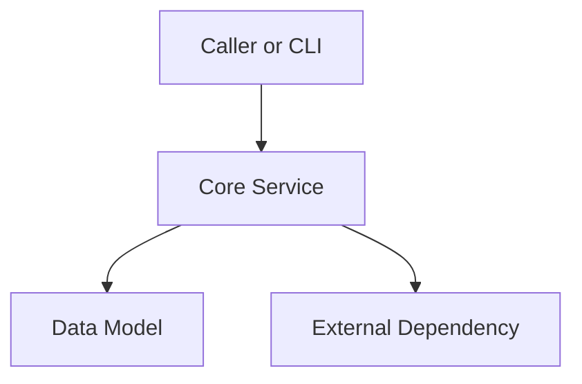

# Technical Implementation Plan: [Feature Name]

- **Feature Identifier**: `[feature-id]`
- **Spec Reference**: `.specs/[feature-id]/spec.md`
- **Status**: Draft | Approved | In Progress | Completed
- **Created**: YYYY-MM-DD

---

## 1. Architectural Design & Component Layout

### Overview
[Explain the technical approach, structural design, and component responsibilities.]

### Component Interaction Diagram


---

## 2. Layer Boundaries & Dependencies

Review `tach.toml` to verify layer constraints:
- **Module Path**: `src/<package>/<domain>/`
- **Layer**: `cli` | `core`
- **Allowed Dependencies**: [List allowed layers and packages]
- **Forbidden Imports**: [Explicitly prohibited imports]

---

## 3. Interfaces & Public Contracts

Define public protocols, types, and function signatures. Use PEP 695 syntax and frozen slotted dataclasses.

```python
from dataclasses import dataclass
from typing import Protocol


@dataclass(frozen=True, slots=True)
class ExampleModel:
    id: str
    value: int


class ExampleServiceProtocol(Protocol):
    def process(self, item: ExampleModel) -> bool: ...
```

---

## 4. Test Strategy

- **Unit Tests**: Test each pure function and protocol implementation in `tests/test_<module>.py`.
- **Property-Based Tests**: Use `hypothesis` for edge-case fuzzing and boundary conditions.
- **Snapshot Tests**: Use `syrupy` for complex data structures or CLI output formats.
- **Coverage Goal**: 100% branch coverage enforced via `.coveragerc`.

---

## 5. Atomic Task Breakdown

Execute tasks in dependency order. Keep every task under 50 to 100 lines of change.
When a task passes verification and you commit the code, mark as complete and append the short commit hash:
`- [x] **Task 1: [Task Title]** (<sha>)`.

- [ ] **Task 1: [Task Title]**
  - **Scope**: [Description of changes and files affected]
  - **Verification Gate**: `uv run poe test tests/test_<module>.py`

- [ ] **Task 2: [Task Title]**
  - **Scope**: [Description of changes and files affected]
  - **Verification Gate**: `uv run poe test tests/test_<module>.py`

- [ ] **Task 3: [Task Title]**
  - **Scope**: [Description of changes and files affected]
  - **Verification Gate**: `uv run poe test`

- [ ] **Task 4: [Documentation & Quality Gate]**
  - **Scope**: Update docstrings and documentation guides.
  - **Verification Gate**: `uv run poe code-quality`
