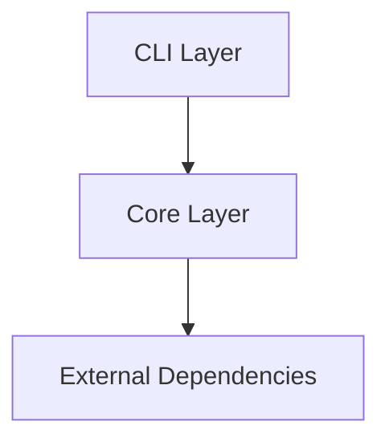

# Zenith Example

<p align="center">
  
</p>

[](https://github.com/bwrob/zenith-example/actions/workflows/python_tests.yaml)

[](https://www.python.org/downloads/)
[](https://github.com/astral-sh/ruff)
[](https://github.com/facebook/pyrefly)
[](.coveragerc)

[](LICENSE)

Demonstration and showcase repository instantiated from the Zenith template.

## 🎯 Elevator Pitch

> **Zenith Example** is a high-velocity, production-grade
> Python project built for developers who refuse to compromise on speed,
> typing rigor, or architectural cleanliness. Engineered for rapid iteration and
> zero-regression craftsmanship, it couples strict static typing and automated
> modular boundaries with instant verification pipelines and live-reloading
> documentation.

## Overview

**Zenith Example** is built with a modern, strict Python
stack designed for reliability, speed, and clean architecture:

- **uv**: Next-generation package manager and PEP 517 build backend.
- **Ruff**: Comprehensive linting and formatting with preview rules.
- **Pyrefly**: Meta's high-performance static type checker in strict mode.
- **complexipy**: Cognitive complexity limits preventing spaghetti logic.
- **Zensical**: Modern static site documentation with MathJax LaTeX support and
  markdown-exec.
- **rumdl**: Rigid markdown formatting and embedded code block linting.
- **typos**: Blazing-fast Rust spell checker for source code and documentation.
- **Tach**: Architecture boundary enforcement preventing circular imports.
- **Hypothesis, Syrupy, & Randomly**: Property-based, snapshot, and randomized
  test ordering with pytest.
- **Typst**: Modern markup-based layout engine for documentation logotypes.
- **Poe the Poet**: Declarative task automation.

## Quick Start

> [!TIP]
> Run `uv run poe --help` to inspect all available workflow tasks and automation
> scripts.

Get started with **Zenith Example** in moments.

### 1. Installation

Install via `uv`:

```bash
uv add zenith-example
```

Or install with pip:

```bash
pip install zenith-example
```

### 2. Library Usage

```python
from zenith_example import get_greeting

message = get_greeting("World")
print(message)
```

### 3. Command Line Interface

Execute the CLI commands via `uv run`:

```bash
# Display help and available commands
uv run zenith-example --help

# Run greet command
uv run zenith-example greet "Developer"
```

## Development Setup

Get your local development environment ready in three steps:

### 1. Install Dependencies

```bash
git clone https://github.com/bwrob/zenith-example.git
cd zenith-example
uv sync
```

### 2. Run Tests with Coverage

Run unit tests and verify code coverage:

```bash
uv run poe test
```

Generate an interactive HTML coverage report in `htmlcov/`:

```bash
uv run poe coverage
```

### 3. Run Quality Checks

Verify that the codebase satisfies all strict linting, typing, complexity,
and architectural rules:

```bash
uv run poe code-quality
```

### 4. Serve Documentation

Preview the documentation locally with live reload and MathJax rendering:

```bash
uv run poe docs-serve
```

## Architecture & Boundaries

Architecture rules are defined and enforced with **Tach**:



Run `uv run poe dependencies` to validate that no layer violations or circular
dependencies occur.

## Mathematical Specifications

Documentation formulas are rendered via **Zensical** and **MathJax**:

$$
\mathcal{L}(\theta) = \frac{1}{N} \sum_{i=1}^N \ell\left(f(x_i; \theta), y_i\right)
$$

Inline equations like $E = mc^2$ and $\Omega(n)$ are supported out of the box.

## Available Poe Tasks

| Task | Command | Description |
|---|---|---|
| **Quality** | `uv run poe code-quality` | Runs lint, format-check, lint-md, typos, type-check, complexity, tach |
| **Test** | `uv run poe test` | Executes pytest with doctests and coverage thresholds |
| **Test Fast** | `uv run poe test-fast` | Runs tests in parallel across CPU cores with pytest-xdist |
| **Snapshots** | `uv run poe test-snapshot-update` | Updates syrupy test snapshots |
| **Coverage** | `uv run poe coverage` | Creates detailed HTML coverage report |
| **Lint** | `uv run poe lint` | Checks code against all Ruff rules |
| **Format** | `uv run poe format` | Formats code with Ruff |
| **Format Check** | `uv run poe format-check` | Verifies code format with Ruff without modifying files |
| **Format TOML** | `uv run poe format-toml` | Formats TOML configuration files with Taplo |
| **Format Check TOML** | `uv run poe format-check-toml` | Verifies TOML format with Taplo without modifying files |
| **Markdown** | `uv run poe lint-md` | Lints markdown files with rumdl |
| **Typos** | `uv run poe typos` | Checks source code and documentation for typos |
| **Typos Fix** | `uv run poe typos-fix` | Automatically fixes typos across the codebase |
| **Types** | `uv run poe type-check` | Performs strict type analysis with Pyrefly |
| **Complexity** | `uv run poe complexity` | Evaluates cognitive complexity with complexipy |
| **Boundaries** | `uv run poe dependencies` | Validates modular boundaries with Tach |
| **Skills Check** | `uv run poe check-skills` | Validates structural invariants and frontmatter of agent skills |
| **Mutation** | `uv run poe test-mutation` | Runs fast mutation testing across package source with mutmut |
| **Mutation Distributed** | `uv run poe test-mutation-cosmic` | Runs distributed mutation testing with cosmic-ray |
| **Interactive REPL** | `uv run poe repl` | Launches interactive Python REPL with package pre-loaded |
| **Docs** | `uv run poe docs-serve` | Starts local Zensical documentation server |
| **Build Docs** | `uv run poe docs-build` | Compiles documentation into `site/` |
| **Logotype** | `uv run poe docs-logo` | Compiles documentation logotype SVG with Typst |
| **Verify Wheel** | `uv run poe verify-wheel` | Verifies clean package and entry-point imports in an isolated wheel environment |

## Configuration Blueprint

| File | Purpose |
|---|---|
| `pyproject.toml` | Project metadata, dependencies, and `uv_build` backend |
| `poe_tasks.toml` | Task runner configuration with `uv` executor |
| `ruff.toml` | Strict Ruff linter and formatter configuration |
| `pyrefly.toml` | Pyrefly strict preset and project path definitions |
| `complexipy.toml` | Cognitive complexity threshold rules (`max = 10`) |
| `zensical.toml` | Zensical docs, mkdocstrings, Mermaid, and MathJax |
| `rumdl.toml` | Rigid markdown rules and embedded code block checkers |
| `typos.toml` | Typos spell check exclusions and dictionary rules |
| `tach.toml` | Modular architecture layer hierarchy |
| `cosmic-ray.toml` | Distributed mutation testing configuration |
| `AGENTS.md` / `CLAUDE.md` | Operational instructions and guardrails for AI coding assistants |
| `SECURITY.md` | Coordinated vulnerability disclosure and security policy |
| `CONTRIBUTING.md` | Contribution guidelines, AI policy, and workflow instructions |
| `CODE_OF_CONDUCT.md` | Contributor Covenant v2.1 standards |
| `docs/adr/` | Architecture Decision Records (ADRs) |
| `.coveragerc` | Mandatory 100% test coverage target and exclusions |
| `pytest.ini` | Test paths and verbose output options |

## License

Distributed under the MIT License. See [LICENSE](LICENSE) for details.
