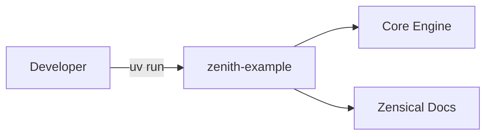

# Zenith Example

<p align="center">
  
</p>

Welcome to the documentation for **Zenith Example**.

Demonstration and showcase repository instantiated from the Zenith template.



## Quick Start CLI

<div class="termy">

```console
$ uv run zenith-example greet "World"

✨ Hello, World!

// Inspect CLI options and help
$ uv run zenith-example --help

<b>Usage: </b><b>zenith-example [OPTIONS] COMMAND [ARGS]...</b>

╭─ Options ─────────────────────────────────────────╮
│ --version  -v        Show version and exit.       │
│ --help               Show this message and exit.  │
╰───────────────────────────────────────────────────╯
╭─ Commands ────────────────────────────────────────╮
│ greet                Display a personalized       │
│                      greeting.                    │
╰───────────────────────────────────────────────────╯
```

</div>

## Installation

=== "uv (Recommended)"

```bash
uv add zenith-example
```

=== "pip"

```bash
pip install zenith-example
```

> [!TIP]
> Always run project commands via `uv run poe <task>` or `uv run <command>`. This
> guarantees hermetic execution inside the managed virtual environment without manual
> activation.

## Highlights

- **uv**: Next-generation package manager and PEP 517 build backend.
- **Ruff**: Comprehensive linting and formatting with preview rules.
- **Pyrefly**: Meta's high-performance static type checker in strict mode.
- **complexipy**: Cognitive complexity limits preventing spaghetti logic.
- **Zensical**: Modern static site documentation with MathJax LaTeX support and
  markdown-exec.
- **rumdl**: Rigid markdown formatting and embedded code block linting.
- **typos**: Blazing-fast Rust spell checker for source code and documentation.
- **Tach**: Architecture boundary enforcement preventing circular imports.
- **Hypothesis, Syrupy, & Randomly**: Property-based, snapshot, and randomized
  test ordering with pytest.
- **Typst**: Modern markup-based layout engine for documentation logotypes.
- **Poe the Poet**: Declarative task automation.

## Architecture & Project Layout

```tree
./
├── pyproject.toml
├── poe_tasks.toml
├── zensical.toml
├── src/
│   └── zenith_example/
│       ├── __init__.py
│       ├── cli.py
│       └── core.py
├── tests/
│   └── test_core.py
└── docs/
    ├── index.md
    ├── getting-started.md
    ├── reference.md
    ├── adr/
    │   ├── index.md
    │   └── 0001-record-architecture-decisions.md
    └── changelog.md
```

> [!NOTE]
> The directory tree illustrates the core layout generated by Zenith, cleanly separating
> package source, automated test suites, and documentation.

## Mathematical Notation

LaTeX equations are fully supported via MathJax:

$$
f(x) = \int_{-\infty}^\infty \hat{f}(\xi)\,e^{2 \pi i \xi x}\,d\xi
$$

Inline equations such as $E = mc^2$ and $\mathcal{O}(n \log n)$ render smoothly.

## Dynamic Code Execution

Execute embedded Python and shell snippets at documentation build time:

```python exec="on"
import sys

print(f"Docs built with Python {sys.version.split()[0]} via markdown-exec!")
```

## Next Steps

- Follow the [Getting Started](getting-started.md) guide to set up your environment.
- Review the [API Reference](reference.md) for module details.
- Consult [Architecture Decision Records (ADRs)](adr/index.md) for key design choices.
- Review the [Changelog](changelog.md) for release history.
