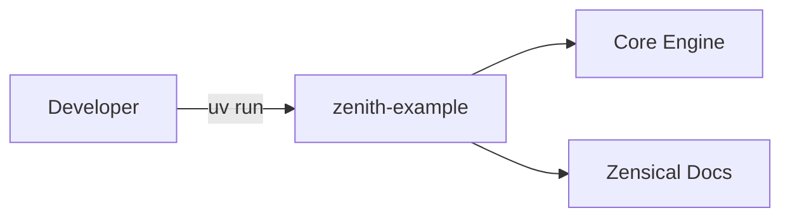

# Zenith Example

<p align="center">
  
</p>

Welcome to the documentation for **Zenith Example**.

Demonstration and showcase repository instantiated from the Zenith template.



## Quick Start CLI

<div class="termy">

```python exec="on"
import os
import subprocess

env = {**os.environ, "COLUMNS": "80", "NO_COLOR": "1"}
res_greet = subprocess.run(
    ["uv", "run", "zenith-example", "greet", "World"],
    capture_output=True,
    text=True,
    env=env,
    check=True,
)
res_help = subprocess.run(
    ["uv", "run", "zenith-example", "--help"],
    capture_output=True,
    text=True,
    env=env,
    check=True,
)
greet_out = "\n".join(line.rstrip() for line in res_greet.stdout.splitlines())
help_out = "\n".join(line.rstrip() for line in res_help.stdout.splitlines())

print("```console")
print('$ uv run zenith-example greet "World"')
print()
print(greet_out)
print()
print("// Inspect CLI options and help")
print("$ uv run zenith-example --help")
print()
print(help_out)
print("```")
```

</div>

## Installation

=== "uv (Recommended)"

    ```bash
    uv add zenith-example
    ```

=== "pip"

    ```bash
    pip install zenith-example
    ```

> [!TIP]
> Always run project commands via `uv run poe <task>` or `uv run <command>`. This
> guarantees hermetic execution inside the managed virtual environment without manual
> activation.

## Highlights

- **uv**: Next-generation package manager and PEP 517 build backend.
- **Ruff**: Comprehensive linting and formatting with preview rules.
- **Pyrefly**: Meta's high-performance static type checker in strict mode.
- **complexipy**: Cognitive complexity limits preventing spaghetti logic.
- **Zensical**: Modern static site documentation with MathJax LaTeX support and
  markdown-exec.
- **rumdl**: Rigid markdown formatting and embedded code block linting.
- **typos**: Blazing-fast Rust spell checker for source code and documentation.
- **Tach**: Architecture boundary enforcement preventing circular imports.
- **Hypothesis, Syrupy, & Randomly**: Property-based, snapshot, and randomized
  test ordering with pytest.
- **Typst**: Modern markup-based layout engine for documentation logotypes.
- **Poe the Poet**: Declarative task automation.

## Architecture & Project Layout

```python exec="on"
from pathlib import Path

KEY_CONFIGS = ["pyproject.toml", "poe_tasks.toml", "zensical.toml"]
PRIMARY_DIRS = ["src", "tests", "docs"]

lines = ["./"]
lines.extend(f"  {f}" for f in KEY_CONFIGS if Path(f).exists())


def walk_dir(d: Path, indent: str) -> None:
    items = sorted(d.iterdir(), key=lambda p: (not p.is_dir(), p.name.lower()))
    for item in items:
        if item.name.startswith(
            (
                ".",
                "__pycache__",
                "__snapshots__",
                "assets",
                "javascripts",
                "stylesheets",
            )
        ):
            continue
        if item.name.endswith((".pyc", ".pyo")):
            continue
        if item.is_dir():
            lines.append(f"{indent}{item.name}/")
            walk_dir(item, indent + "  ")
        else:
            lines.append(f"{indent}{item.name}")


for d in PRIMARY_DIRS:
    dp = Path(d)
    if dp.is_dir():
        lines.append(f"  {d}/")
        walk_dir(dp, "    ")

print("```tree")
for line in lines:
    print(line)
print("```")
```

> [!NOTE]
> The directory tree above is rendered dynamically at documentation build time using
> the `markdown-exec` plugin with the ` ```tree ` fence.

## Mathematical Notation

LaTeX equations are fully supported via MathJax:

$$
f(x) = \int_{-\infty}^\infty \hat{f}(\xi)\,e^{2 \pi i \xi x}\,d\xi
$$

Inline equations such as $E = mc^2$ and $\mathcal{O}(n \log n)$ render smoothly.

## Dynamic Code Execution

Execute embedded Python and shell snippets at documentation build time:

```python exec="on"
import sys

print(f"Docs built with Python {sys.version.split()[0]} via markdown-exec!")
```

## Next Steps

- Follow the [Getting Started](getting-started.md) guide to set up your environment.
- Review the [API Reference](reference.md) for module details.
- Consult [Architecture Decision Records (ADRs)](adr/index.md) for key design choices.
- Review the [Changelog](changelog.md) for release history.
